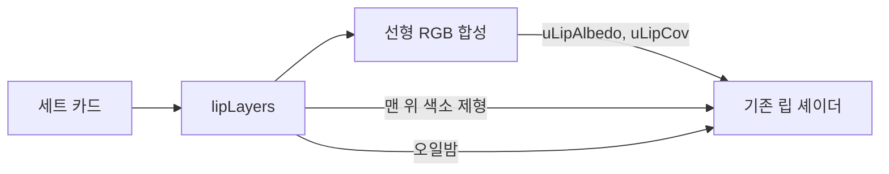

# 립 겹쳐 바르기

명세 [docs/AR_SPEC.md](docs/AR_SPEC.md) F18(겹쳐 바르기)의 최소 구현이다. 카탈로그 전체 자동 추천은 하지 않는다. 입술 마스크·주름·볼륨 셰이더는 그대로 두고, 들어가는 색과 제형 유니폼만 바꾼다.

## 구분

세트는 코드에 고정한다. 새 파일 [lib/lipLayers.ts](lib/lipLayers.ts). 각 항목은 `id`, 아래→위 `shades[]` (productId, shadeId, 역할 `base` | `color` | `care`).

넣는 조건 (세트 작성 규칙, 런타임 탐색 아님):

- 색상각이 같은 장미·코랄·누드 계열. 초록·노랑 오일을 분홍 위에 올리지 않음.
- 위 색소는 아래보다 밝거나 커버가 낮은 글로시. 매트 두 장을 같은 진하기로 겹치지 않음.
- 이름에 오일·밤이 있으면 [lib/lipCare.ts](lib/lipCare.ts) `lipCareKind` 기준 **케어 층**. 색소 층으로 세지 않음.
- hex는 카탈로그 추정치이므로 UI에 실측이라고 쓰지 않음.

처음 4세트 (이미 카탈로그에 있는 id):

- 롬앤 베어 그레이프 `oy-a000000241210` / `03` → 쥬시 플래시 플래시 온 `oy-a000000252485` / `00`
- 에이오유 슴슴바 `oy-a000000229303` / `03` → 같은 플래시 온
- 딘토 아베 마리아 `oy-a000000201123` / `219` → 컬러그램 행복숭아 `oy-a000000221670` / `03`
- 아베 마리아 → 이더앤 멜트어웨이 `oy-a000000233656` / `01` → 플래시 온 (색소 2 + 케어 1)

## 쓰기

[app/(tabs)/ar.tsx](app/(tabs)/ar.tsx) 립 탭에 제형 칩과 같은 줄에 **겹쳐 바르기** 칩. 켜면 스와치 대신 세트 카드(아래 색 원 → 위 색 원, 제품명). 카드를 누르면 그 순서만 적용하고, 기존 단일 립 선택은 비운다.

상태: [types/index.ts](types/index.ts) `MakeupState`에 `lipLayers?: ZoneSetting[] | null` (최대 3, 앞이 아래). 호환을 위해 `lip`은 맨 아래 색소, `lipCare`는 맨 위 케어(오일·밤)로 같이 채운다. `lipLayers`가 없으면 지금처럼 `lip` 하나만 그린다. [store/makeupStore.ts](store/makeupStore.ts)에 `applyLipSet` / 세트 해제. 단일 제품을 다시 고르면 세트를 지운다.

i18n 네 언어 ([lib/i18n](lib/i18n)): 칩 이름, “아래”, “위”, 세트 짧은 이름.

## 덧바름

[components/ar/faceTrackerHtml.ts](components/ar/faceTrackerHtml.ts) `lipCoverage`를 층 위치에 따라 나눈다.

- 맨 아래 색소: 지금 식. `layers = intensity × layersPerIntensity`(기본 0.65 → 약 2번), `1 - (1 - a1)^layers`.
- 그 위 색소: 한 번만. `1 - (1 - a1)`. `layersPerIntensity`를 곱하지 않음.
- 케어: 지금 `lipCoverage`의 care 식 그대로 `(0.10 + 0.10 × intensity) × tint × 0.6`. 더 깎지 않음.

`uLipTranslucent`로 위층을 약하게 만들지 않는다.

## 색

CPU에서 선형 RGB로만 접는다. 셰이더 립 루프는 그대로 두고 결과만 `uLipAlbedo`, 총 덮임을 `uLipCov`로 넘긴다.

- 시작색은 맨 아래 제품 hex (맨입술 측정색은 셰이더의 `rPx`가 이미 담당).
- 색소 층마다 `mix(아래, hexLinear, cov)`. `translucent > 0`이면 지금 프래그먼트와 같은 `filt` 곱을 그 층에만 적용.
- 총 덮임 `1 - Π(1 - cov)`. 1로 고정하지 않음.
- 케어 색은 이 합성에 넣지 않는다. 기존처럼 광택만 덮고, 틴트는 `uLipSheenK` 경로를 유지한다. 케어가 색을 거의 안 바꾸는 지금 동작을 세트가 깨지 않게 한다.

## 광택·질감

맨 위 **색소**의 `MATERIALS`만 roughness, specular, detail, flake, translucent에 쓴다. 세 제형을 평균내지 않는다.

- 글로시가 위면 주름은 남고 윤기가 올라간다.
- 매트가 위면 펄·윤기는 꺼진다. 아래 쉬머 펄은 보이지 않는다.
- 케어가 있으면 지금 `careOver`와 같이 gloss cover·roughness·specular만 케어가 이긴다. 색소 알베도는 케어가 바꾸지 않는다.

## 확인

- 단위 테스트: 세트 4개의 순서·케어 분류, 위층 cov가 아래층 cov보다 작은지(매트 a1 0.72 기준 한 번 약 0.72 vs 기본 진하기 약 0.92), 두 색 mix가 sRGB 평균이 아닌지.
- `npm test` 중 립 커버·faceTracker 관련. 세트 적용 후 `lip`과 `lipCare`가 동시에 채워지는지.
- 실기기 Expo Go에서 세트 하나(아베 마리아 → 멜트어웨이 → 플래시 온)를 보고, 아래 장미가 남고 표면만 번지는지 확인한다. 확인 전에는 완료로 적지 않는다.
